<h1 align="center">Tuneup for TV</h1>

<p align="center">
  Mirá, detené, deshabilitá, restaurá y desinstalá las apps de tu propio Android TV, con el control remoto y sin computadora.
</p>

<p align="center">
  
  
  <a href="https://github.com/icarloscornejo/TuneupForTV/releases/latest"></a>
  
</p>

<p align="center">
  <a href="README.md">Read in English</a>
</p>

<p align="center">
  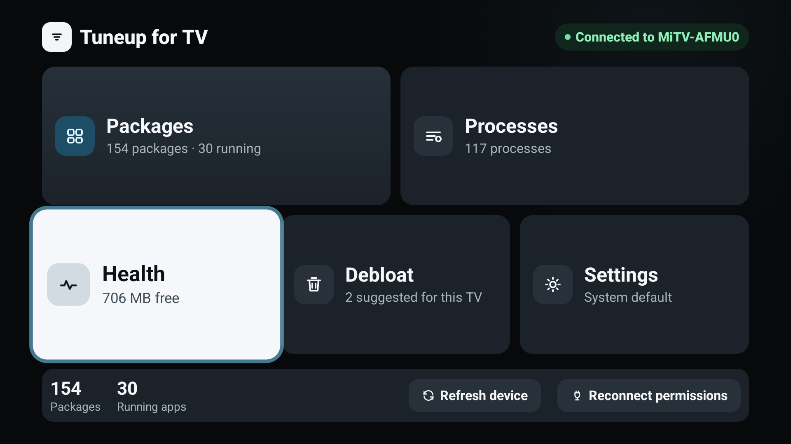
</p>

Tuneup habla con el ADB del propio TV por la red, así que solo funciona en un aparato que controlás vos. Está hecho con
Kotlin y Jetpack Compose para un control remoto con cruceta, y probado en un Sony BRAVIA BF1 y un Xiaomi MiTV.

Nació inspirada en [backgroundappslist](https://github.com/visnkmr/backgroundappslist), una pequeña app legendaria que
mostraba qué corre en segundo plano. Tuneup lleva esa idea a la pantalla grande y va más lejos: actúa sobre lo que
muestra, con seguridad y con una forma de volver atrás.

Y cuando termina la limpieza, un último paso opcional ofrece **LightLauncher**: un launcher diminuto con la calma visual
de la pantalla de inicio de Apple TV pero con aire Android. Es para quien solo quiere un TV limpio, sin temas, sin
widgets y sin ajustes interminables: solo velocidad y sencillez.

## Qué hace

<table>
  <tr>
    <td width="50%">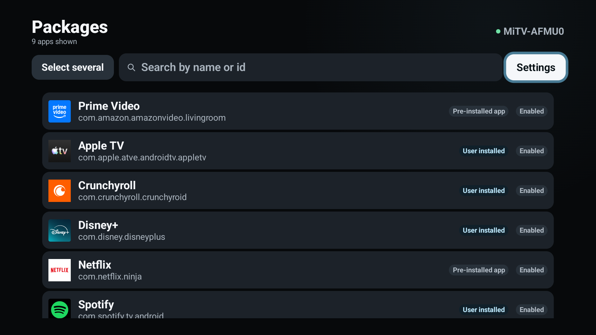<br><b>Paquetes</b><br>Cada app con su categoría y estado. Deshabilitá, restaurá, forzá la detención y desinstalá una o varias a la vez.</td>
    <td width="50%">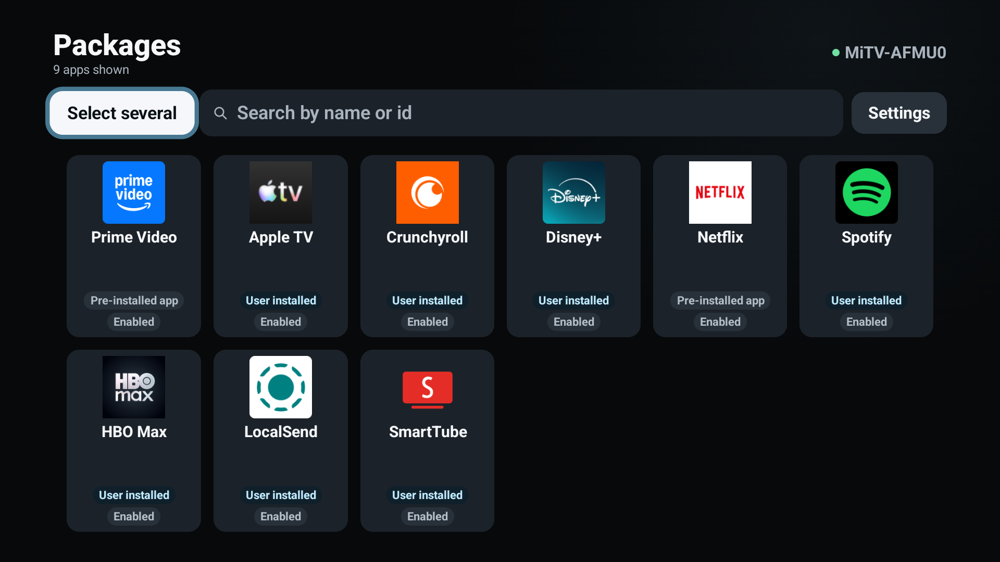<br><b>Lista o cuadrícula</b><br>Paquetes y Procesos guardan cada uno su vista, orden, visibilidad y categorías.</td>
  </tr>
  <tr>
    <td width="50%">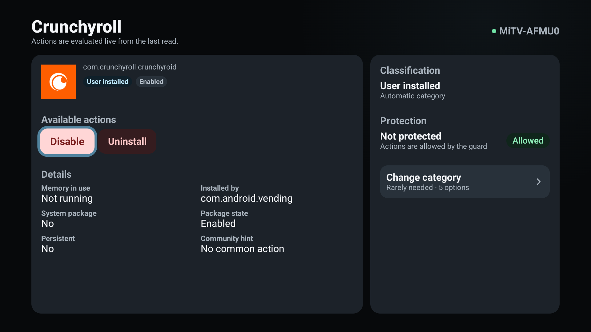<br><b>Página del paquete</b><br>Las acciones que permite la guarda, los detalles, y por qué un paquete está protegido cuando lo está.</td>
    <td width="50%">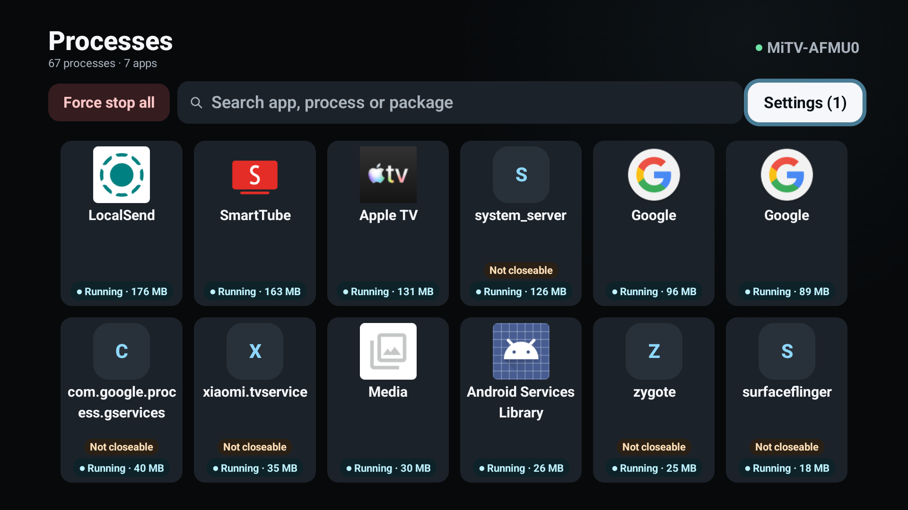<br><b>Procesos</b><br>Qué corre ahora y cuánta memoria usa. Forzá la detención de una app o de todo lo listado, y avisa cuando Android abre una otra vez.</td>
  </tr>
  <tr>
    <td width="50%">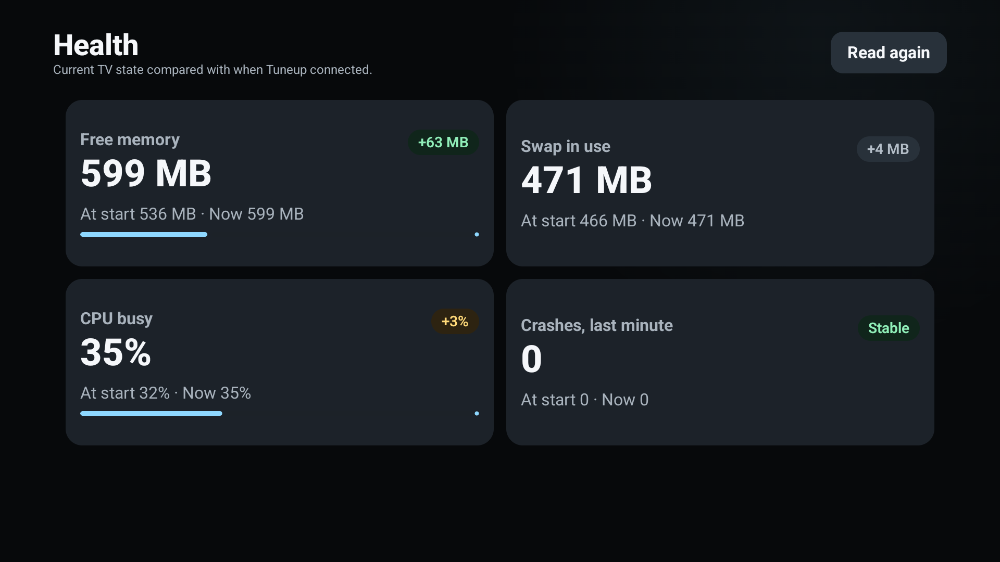<br><b>Salud</b><br>Memoria, swap, CPU y fallos recientes, comparados con el inicio de la sesión.</td>
    <td width="50%">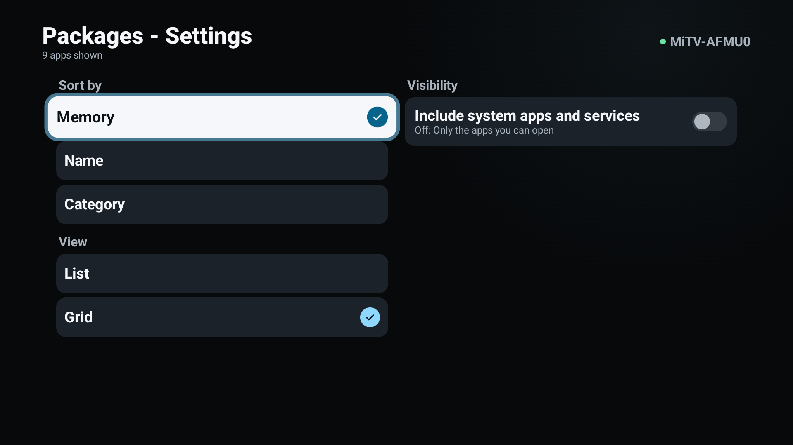<br><b>Ajustes de cada lista</b><br>Orden, vista, y si se incluyen las apps y servicios del sistema.</td>
  </tr>
</table>

Todo cambio pregunta primero, dice qué va a hacer y queda escrito en un diario, así que un cambio a medias se encuentra
y se muestra en el siguiente arranque.

<table>
  <tr>
    <td width="50%">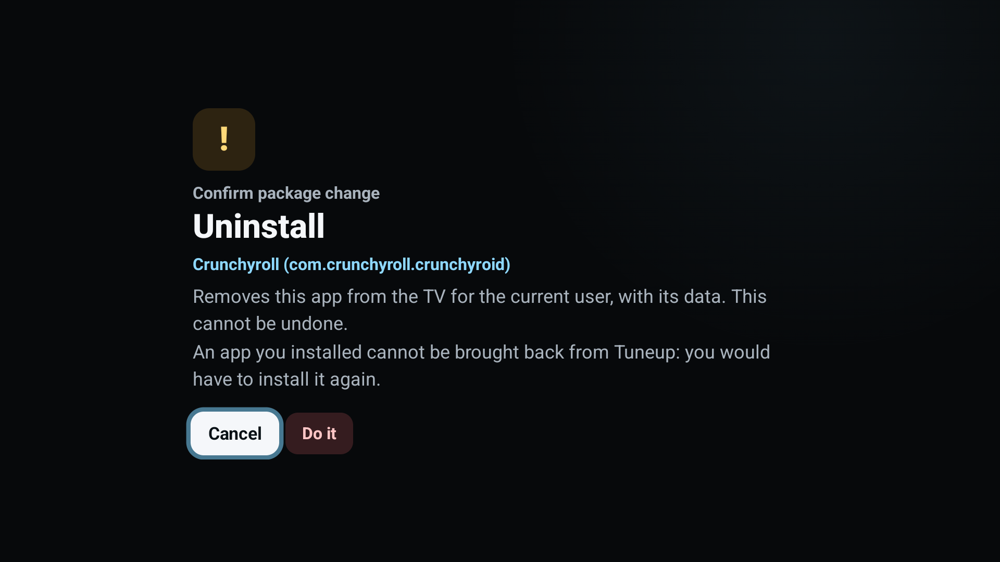</td>
    <td width="50%">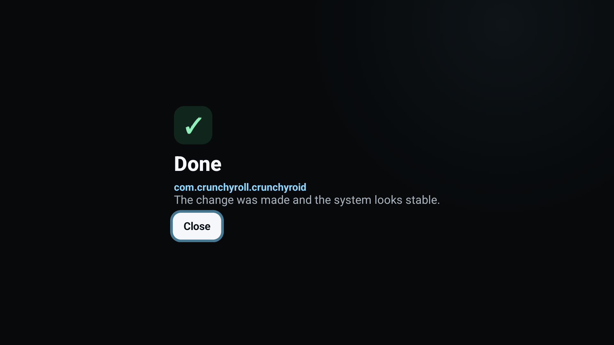</td>
  </tr>
  <tr>
    <td width="50%">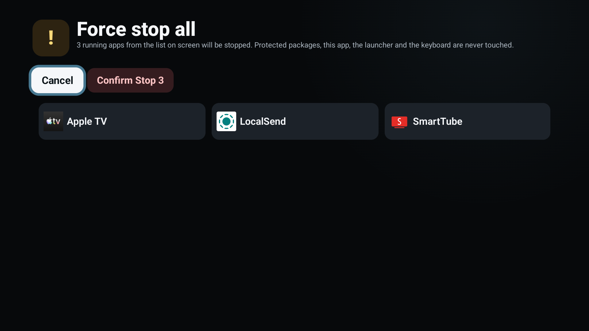</td>
    <td width="50%">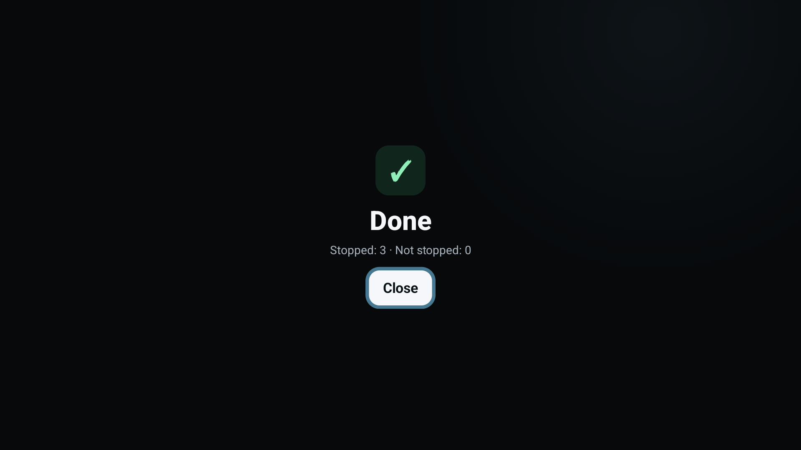</td>
  </tr>
</table>

## Limpieza, paso a paso

La lista hecha para este TV (elegida por marca y modelo), aplicada un paquete a la vez y totalmente reversible. La
primera vez te guía un asistente: elegir, confirmar, limpiar, resultado y, al final y opcional, un launcher más liviano.

<table>
  <tr>
    <td width="33%">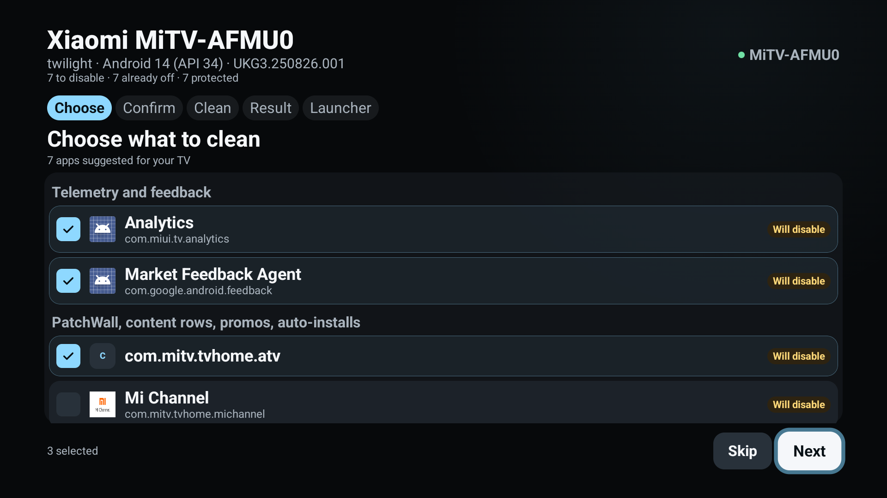<br><b>1. Elegir</b></td>
    <td width="33%">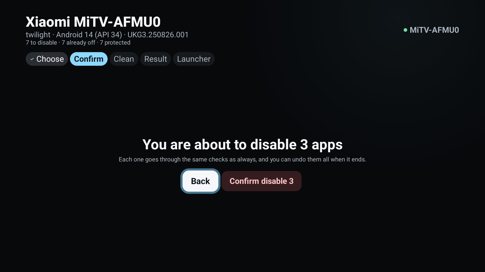<br><b>2. Confirmar</b></td>
    <td width="33%">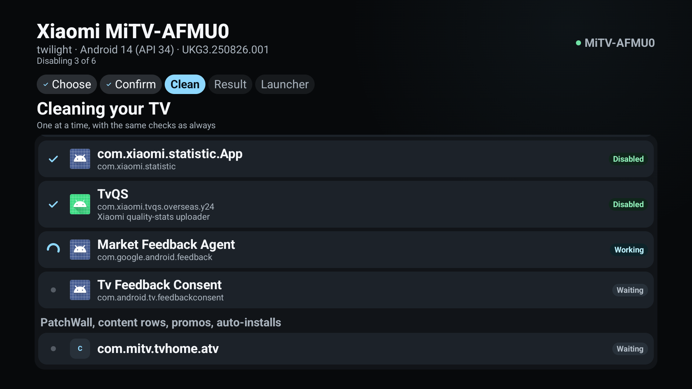<br><b>3. Limpiar</b></td>
  </tr>
  <tr>
    <td width="33%">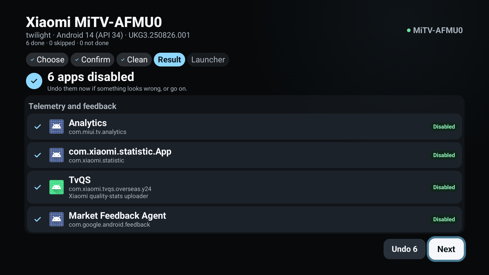<br><b>4. Resultado</b>, con Deshacer</td>
    <td width="33%">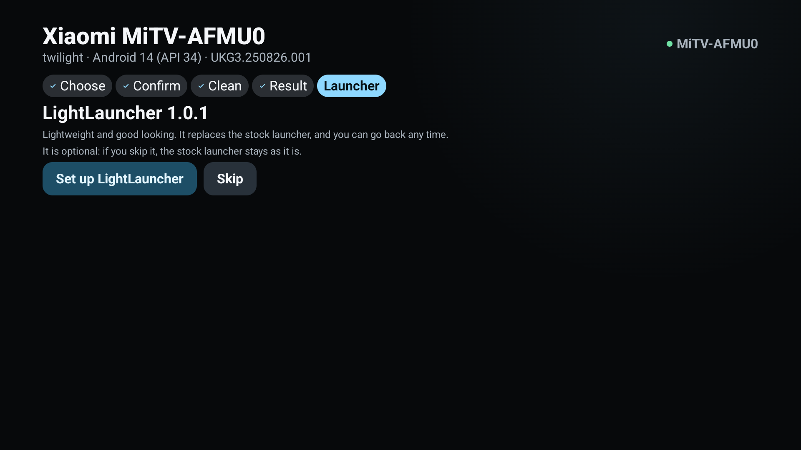<br><b>5. Launcher</b>, opcional</td>
    <td width="33%">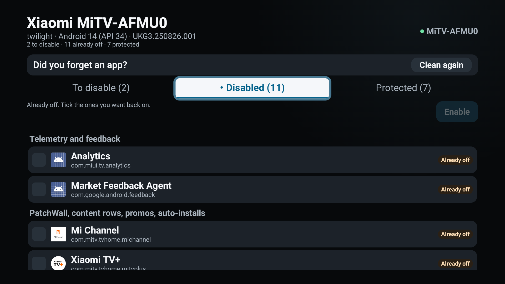<br><b>Después</b>, tres pestañas</td>
  </tr>
</table>

**Cuando un paquete falla**, la limpieza no se detiene. Un paquete que el TV rechaza se salta y la corrida sigue con el
resto; su fila muestra lo que dijo el TV, palabra por palabra, para que puedas sacarle una foto y reportarlo. Al final
podés deshacer solo los que fallaron, deshacer todo, o seguir con lo que quedó pendiente. La corrida solo se detiene
cuando un cambio deja algo para que decidás, y entonces pregunta: dejarlo así, o deshacerlo y seguir. Lo mismo funciona
con varios paquetes elegidos en la pantalla de Paquetes.

## Instalación

1. Bajá `TuneupForTV-X.Y.Z.apk` del [último release](https://github.com/icarloscornejo/TuneupForTV/releases/latest).
2. Mandalo del cel al TV con [LocalSend](https://localsend.org) (gratis y de código abierto; instalalo en los dos, con
   el mismo Wi-Fi).
3. Abrí el APK en el TV e instalalo. El TV puede pedirte que permitas instalar desde la app que recibió el archivo.

Las versiones siguientes llegan desde la propia app: **Ajustes > Buscar actualización** baja el release nuevo, lo
revisa contra el hash publicado con él y el TV te pide confirmar. Tuneup también busca una vez al abrirse y lo avisa en
la tarjeta de Ajustes cuando hay una versión nueva.

## Primer arranque

La app lee y cambia el TV a través de su propio ADB, así que la primera vez el TV te pide que confíes en ella: activá la
depuración por red en las opciones de desarrollador del TV, abrí Tuneup y, en el aviso, elegí **Permitir siempre** y
luego **Permitir**.

<table>
  <tr>
    <td width="50%">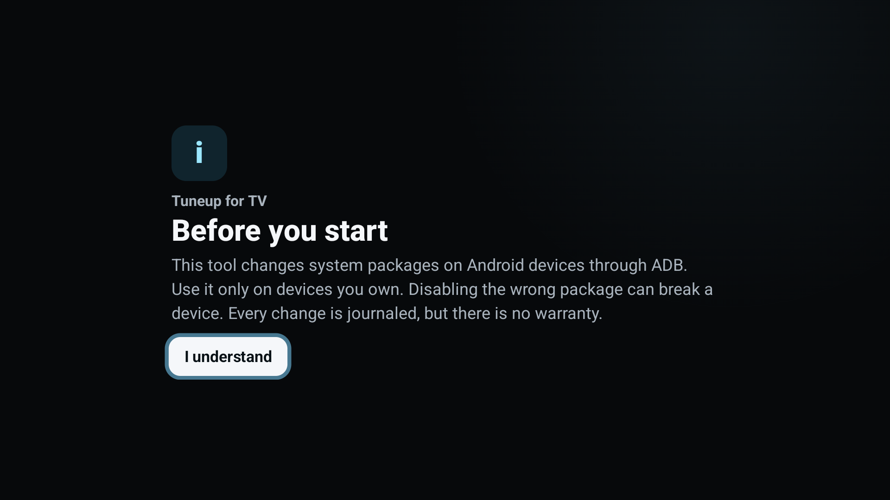</td>
    <td width="50%">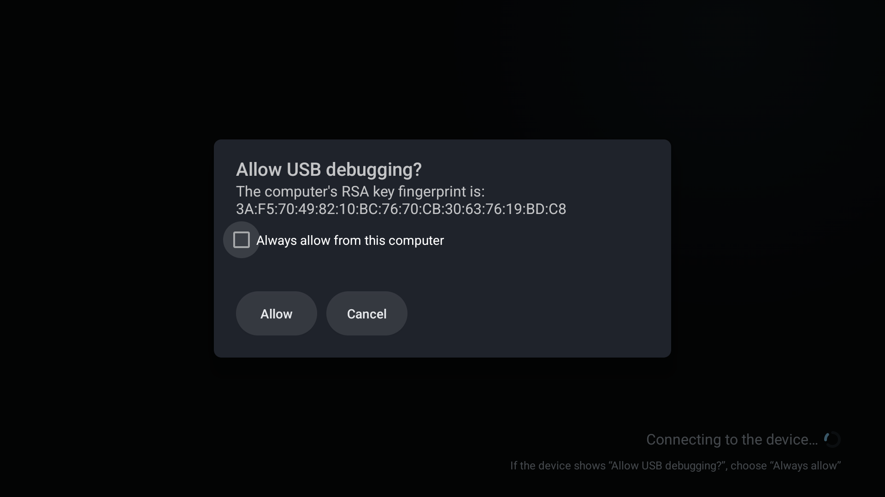</td>
  </tr>
</table>

## Compilar

JDK 17+ y el SDK de Android.

```
./gradlew :app:testDebugUnitTest
./gradlew :app:assembleDebug
```

## Listas de limpieza

La pantalla de limpieza trae 416 listas de [cleanyourtv](https://github.com/Gathin23/cleanyourtv) (MIT, licencia en
`app/src/main/assets/licenses/cleanyourtv.txt`), fijadas al commit `a1e948c665abf5af86c3aab08fe05053686a6bf3`, más
`mi-bravia-bf1.txt`, escrita y probada a mano para el BRAVIA BF1. El commit fijado y su fecha están en
`tools/cleanyourtv.pin`.

## Descarga del launcher

El launcher no viene dentro de la app. Cuando se abre el paso del launcher, Tuneup le pide a GitHub el último release de
[icarloscornejo/LightLauncher](https://github.com/icarloscornejo/LightLauncher) y busca dos archivos: el único `.apk`, y
un archivo `.sha256` con el mismo nombre más `.sha256` (por ejemplo `shasum -a 256 app-release.apk >
app-release.apk.sha256`). La etiqueta debe ser `vX.Y.Z`; la versión sale de ella.

El APK se descarga solo después de que confirmás, por https, y se instala solo si su SHA-256 es el publicado en ese
release. El hash viene del mismo release, así que quien controla ese release controla el APK: la confianza está en la
cuenta de GitHub que lo publica, y la firma no se fija.

Sin internet, sin repositorio, sin release, un archivo que falta o un hash que no coincide significan lo mismo: el
launcher no está disponible, no se instala nada, y el paso se puede saltar o intentar de nuevo. A un TV que ya tiene un
LightLauncher más nuevo que el publicado nunca se le baja de versión.

## Ideas a futuro

Hacia dónde podría ir Tuneup. Son ideas, no promesas.

- Un limpiador de archivos que nadie usa más (datos sobrantes de apps, cachés y descargas), con las mismas reglas que
  todo lo demás: muestra lo que va a quitar, pregunta primero y lleva un diario.
- Tuneup para un teléfono Android, para cuando preferís no instalarla en el TV: toda la app (paquetes, procesos,
  salud, limpieza y el launcher) manejada desde el teléfono como un control remoto, por el ADB del TV en la red, con la
  misma guarda y la misma forma de volver atrás.

## Licencia
Ver [LICENSE](LICENSE).
